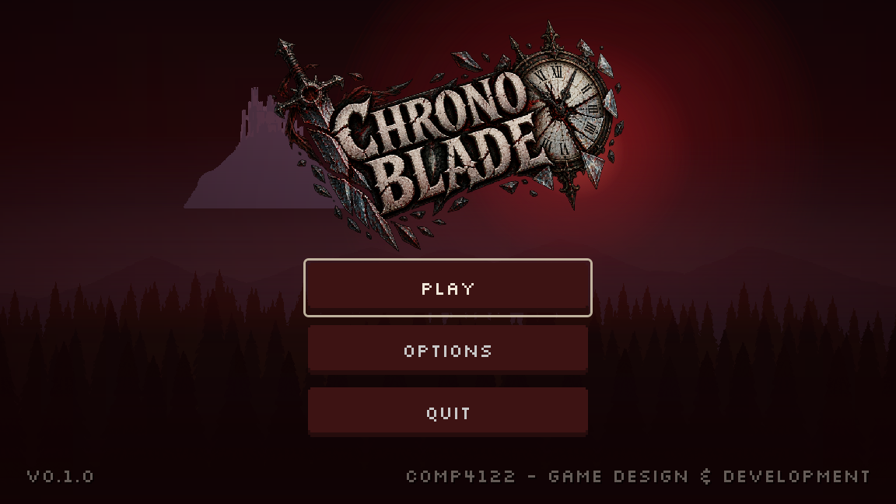

# Chrono Blade — UI layer

The UI is built from the project's own art direction: the pixel UI kit in
`Assets/UI/FreeHorrorUi.png`, the stone-and-blood logo in
`Assets/generated/chrono_blade_title.png`, and the parallax castle/forest layers
in `Assets/Scene/Backgrounds`. Nothing was redrawn — images were re-composited
and re-tinted, and a few missing icons were authored pixel-by-pixel to match.



---

## 1. Design language

**Palette** (sampled from the kit, so new elements sit next to it naturally)

| role | hex | used for |
| --- | --- | --- |
| void | `#0B0708` | page background, fade cover |
| panel | `#120C0D` | cards, HUD plates |
| blood | `#3D1313` | button fill (from the kit's own pill) |
| crimson | `#B02A31` | accents, section titles, health |
| ember | `#C85C50` | hover tint |
| bone | `#D9D2C6` | primary text |
| ash | `#9C938A` | secondary text |
| gold | `#C9962B` | XP, currency |

**Scale.** The kit is pixel art authored for a 3x presentation (its buttons are
52x15, the original scenes stretched them to 156x45). Everything here is built at
that 3x scale on a **1152x648** canvas: 8px UI type becomes 24px, a 16px icon
becomes 48px, and a 15px-tall button is 45px tall.

**Type.** Two licensed (OFL) faces, both in `UI/Fonts/`:

- **Silkscreen** at 24px — every label, button and number. Imported with
  antialiasing, hinting and subpixel positioning **off** so it stays a crisp
  pixel font at 3x.
- **Cinzel** — headings only (`TitleLabel`, `HeadingLabel`), for the engraved
  stone lettering of the logo.

**Stretch.** `project.godot` now sets explicit `1152x648` viewport dimensions and
`window/stretch/aspect="keep"`. The canvas is designed once and scaled uniformly,
so the UI is identical on every monitor instead of re-flowing and shrinking.

---

## 2. Files

```
UI/
  theme/chrono_blade_theme.tres   the whole look: fonts, 9-slices, colours, variations
  Fonts/                          Silkscreen + Cinzel, with their OFL licences
  Menu.tscn / Menu.gd             title screen
  Lobby.tscn / lobby.gd           the waystation hub (walkable, no start button)
  ShopUI.tscn / shop_ui.gd        the old man's shop overlay
  OptionsMenu.tscn / .gd          options overlay (shared by menu and pause)
  HUD.tscn / hud.gd               in-run HUD
  PauseMenu.tscn / PauseMenu.gd   pause overlay
  GameOver.tscn / GameOver.gd     run summary
  screenshots/                    captures of every screen
Global/
  run_state.gd                    autoload "RunState": hp, coins, xp, rooms
  settings.gd                     autoload "Settings": audio/display prefs
Assets/UI/
  FreeHorrorUi_x3.png             the kit, nearest-neighbour pre-scaled to 3x (9-slice source)
  menu_backdrop.png               composed parallax backdrop (see §6)
  icons/                          coin, gem, shard, chrono, pause, slider, arrow
Assets/Lobby/
  shop_house.png, old_man.png, arrow_sign.png, dead_tree.png, rocks.png,
  lamp_post.png, ground_tile.png, lamp_glow.png
Assets/FX/weather/
  rain_streak.png, snowflake.png, leaf.png
Game/
  Backdrop.tscn / backdrop.gd     six-layer parallax sky + weather per room type
tools/
  gen_lobby_art.py                regenerates Assets/Lobby (Pillow, pixel art)
  gen_weather_art.py              regenerates Assets/FX/weather
  ui_flow_test.tscn / .gd         headless smoke test of the whole UI flow
  ui_capture.tscn / .gd           renders one scene to a PNG
```

The theme is installed globally in `project.godot` (`gui/theme/custom`), so any
scene — including the room scenes — picks it up without extra wiring.

---

## 3. Theme

Everything reusable lives in the theme, not in the scenes. Scenes only carry
layout.

| type / variation | base | purpose |
| --- | --- | --- |
| `Button`, `OptionButton` | — | the kit's crimson pill, 9-sliced from `FreeHorrorUi_x3.png`; hover brightens it 2x, pressed darkens it, disabled swaps to the kit's slate pill |
| `IconButton` | `Button` | square icon button (the pause key) with its own compact box, so focus/hover never changes its size |
| `Panel`, `PanelContainer` | — | dark blood card |
| `CardPanel` | `PanelContainer` | the big centred card used by pause / options / game over |
| `HudPanel` | `PanelContainer` | translucent plate for HUD groups |
| `TitleLabel` / `HeadingLabel` | `Label` | Cinzel headings |
| `MutedLabel` / `SubtitleLabel` | `Label` | dimmed secondary text |
| `HealthBar` / `XPBar` / `ChronoBar` | `ProgressBar` | crimson / gold / bone fills |
| `HSlider` | — | crimson track, bone-and-crimson grabber |

To restyle something, edit the `.tres` — no scene needs to change. To add a
variant, add a `<Name>/base_type = &"<Base>"` entry plus the properties it
overrides, then set `theme_type_variation` on the node.

**9-slicing.** The kit's pill is only 52x15, so its corners are 1px. Drawing it
at 3x would give a 3px radius on a 45px-tall button, so `FreeHorrorUi_x3.png` is
a pre-scaled copy of the whole sheet and the styleboxes take their regions and
margins at 3x. The original PNG is untouched and still used for the hearts.

---

## 4. Screens and flow

```
Menu ──PLAY──▶ Lobby (hub) ──walk into the arrow──▶ Run ──ESC──▶ PauseMenu
 │                 │                                             ├─ RESUME
 │                 ├──[E] at the shop  ──▶ ShopUI                ├─ OPTIONS
 │                 └──[E] at the chest ──▶ +25 coins             ├─ RETURN TO LOBBY
 └──OPTIONS──▶ OptionsMenu (overlay)                             ├─ BACK TO MENU
                                                                └─ QUIT GAME

Run ──hp 0──▶ GameOver ──RETRY──▶ Run
                    └──TITLE──▶ Menu
```

- **Menu** — composed backdrop, breathing logo, keyboard/gamepad focus by
  default. PLAY fades to black and loads `Game/Run.tscn`.
- **OptionsMenu** — a `Control` overlay with a `closed` signal, not a scene. Both
  the menu and the pause menu instantiate it, so the game keeps running behind
  it and "back" simply frees it. The controls table is generated from `InputMap`
  at runtime and therefore cannot disagree with `project.godot`.
- **HUD** — hearts, level + XP, currency, a room banner that names the room type
  and depth, first-run control hints that fade after nine seconds, and the rewind
  gauge (ten segments) driven by the player's live cooldown.
- **PauseMenu** — resumes, opens options, or bails to the title. It owns the
  `paused` flag: nothing else toggles it.
- **GameOver** — appears 0.8s after health reaches zero, summarises rooms/coins/
  level, offers RETRY or TITLE.

- **Backdrop** — one `Game/Backdrop.tscn` lives in `Run.tscn` and is retargeted
  by `scene_manager.gd` on every room swap. It draws the pack's six seasonal
  parallax layers (`Normal BG` / `Autumn BG` / `Winter BG`, back to front:
  layer 5 is the painted sky, layer 1 the near treeline) plus a weather layer,
  picking palette and weather from the room type in `backdrop.gd::PRESETS`.
  Rooms keep their own geometry; only their flat `Background` ColorRect is
  hidden. Colours: combat = dark pine with rain, puzzle = cold blue with snow,
  shop = bright gold afternoon with leaves, boss = violet storm with lightning,
  lobby = dark olive autumn.
- **Lobby** — the waystation hub, and the only screen with no PLAY button. It is
  a camp built from the pack's props: a weathered wooden stall stands at the far
  left — shingled roof with missing tiles, carved SHOP board, torn awning, a
  lantern on each post and the old man at the counter — then a resting tent and
  campfire, and a weathered arrow at the right starts the run. `[E]` trades at the shop, opens the chest, and rests
  at the tent to heal. Warm additive light pools under the shop and the fire
  and a vignette overlay give the camp its lit-at-night feel. Arriving shows a sign card ("THE LAST LAMP / WAYSTATION") using the
  same panel language as the in-run room banner. A hub visit restores health and
  keeps coins, because coins are the shop's currency rather than run score.

---

## 5. Runtime data

`RunState` (autoload) is the only source of truth for anything the HUD shows.
The HUD never owns gameplay numbers and never asks the player for them, except
the rewind cooldown, which is genuinely per-player state.

```gdscript
RunState.damage(1)        # enemy.gd calls this; i-frames are handled inside
RunState.heal(1)
RunState.add_coins(25)
RunState.add_xp(30)       # levels up and re-emits progress_changed
RunState.enter_room()     # scene_manager.gd calls this per transition
```

Signals: `health_changed`, `resources_changed`, `progress_changed`,
`run_started`, `run_ended`. A run is reset in exactly one place,
`Game/scene_manager.gd::_ready()`.

`Settings` (autoload) persists volume, fullscreen, V-Sync and resolution to
`user://settings.cfg`. The project only ships a Master bus, so the Music and SFX
buses are created on demand. Display settings are only pushed to the window once
a config file exists, so a fresh clone keeps `project.godot`'s window size.

**One gameplay hook was added**, in `Entity/enemy.gd`: entering the enemy attack
zone calls `RunState.damage(1)`. Without it the hearts could never move. Remove
that one line if combat damage is meant to live somewhere else.

---

## 6. Derived art

| file | how it was made |
| --- | --- |
| `Assets/UI/FreeHorrorUi_x3.png` | the kit scaled 3x with nearest neighbour, so 9-slice borders land on the 3x grid |
| `Assets/UI/menu_backdrop.png` | the five `Normal BG/GandalfHardcore Background layers` plus `Background Castle .png`, composited back-to-front at 1152x648, each tinted darker as it comes forward, with a crimson sky gradient, a blood moon (radial glow), a fog ramp at the skyline, a bottom darkening pass and a vignette |
| `Assets/UI/icons/*.png` | new, authored on a 16x16 grid in the kit's palette (coin, gem, shard, hourglass); the slider grabber and dropdown arrow are emitted at 3x because theme icons draw at texture size |
| `Assets/Lobby/*.png` | new, drawn pixel-by-pixel by `tools/gen_lobby_art.py` (Pillow): `shop_stall` (the weathered store — posts, patched roof, sign, awning, counter, lanterns, crates), the old man, the exit arrow, rocks, logs, the soft light glow and the screen vignette. The script writes a 4x contact sheet into `Assets/Lobby/_preview/`, which carries a `.gdignore` so Godot never imports it. |
| `Assets/FX/weather/*.png` | `tools/gen_weather_art.py`: a 3x16 rain streak, a 5x5 snowflake and a 7x5 leaf, all tiny so the CPUParticles2D emitters keep the chunky pixel look. |

The hearts are cut straight from `FreeHorrorUi.png` with `AtlasTexture` regions
(`Rect2(135, 105, 18, 15)` full, `Rect2(199, 105, 18, 15)` empty).

Fonts are **SIL Open Font License 1.1** — see `UI/Fonts/OFL-Silkscreen.txt` and
`UI/Fonts/OFL-Cinzel.txt`. They may be redistributed with the project.

---

## 7. Tools

```bash
# drive the real UI flow headlessly: run -> pause -> resume -> death -> summary
godot --headless --path . tools/ui_flow_test.tscn

# render a screen to a PNG (needs a GPU; not for CI)
godot --path . tools/ui_capture.tscn -- res://UI/Menu.tscn D:/shots/menu.png 60
godot --path . tools/ui_capture.tscn -- res://Game/Run.tscn D:/shots/run.png 140 pause
```

---

## 8. Notes

- `.godot/` is tracked in this repository, which is unusual and produces a lot of
  churn whenever the editor opens. This branch deliberately commits **no**
  `.godot/` changes; Godot regenerates the new imports on first open. Adding
  `.godot/` to `.gitignore` and untracking it would be a worthwhile cleanup.
- Only 5 hearts are shown; `RunState.max_hp` above 5 would need another heart
  node in `HUD.tscn`.
- The lobby shop and chest award coins through `RunState`; coins survive a run
  on purpose (shop currency, not score). Gems and shards still have no source.
- `Entity/Shadow.tscn` ships a 40x40 debug `ColorRect` that renders as a
  translucent purple square at the player's feet. The hub hides it locally; the
  player workstream should delete it at the source.
- Rooms still paint their platforms in their own colours (combat pink, shop
  green). Those were authored against the old flat backgrounds and now fight
  the new tones; a per-room-type palette pass is the next visual step.
- The lobby hut and old man are placeholders drawn from scratch; they are
  waiting on the reference art for the rounded, semi-2D props.

## 9. Backdrop ground fill

`Game/Backdrop.tscn` draws a solid `GroundFill` sprite from the floor line down.
Rooms hide their own `Background` ColorRect, so without it every room would show
a flat void under the walkable floor. The fill is positioned from the camera's
**clamped screen centre** (`get_screen_center_position()`) rather than the camera
node's position — that way it lines up exactly with world y=640 and, like the
parallax, it stays perfectly still while the camera is held by its limits.
